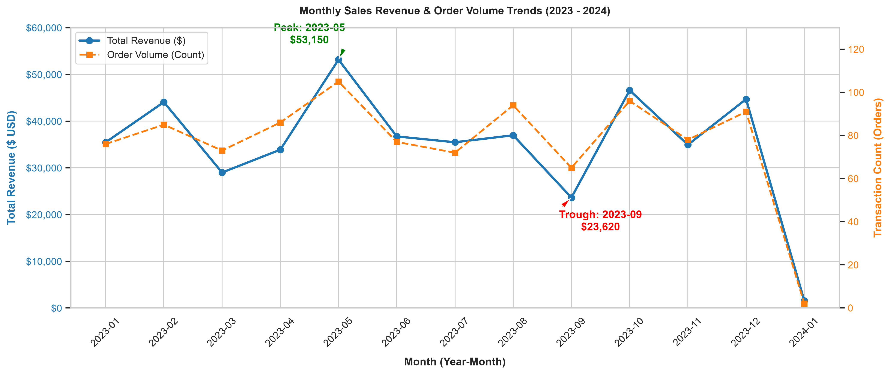
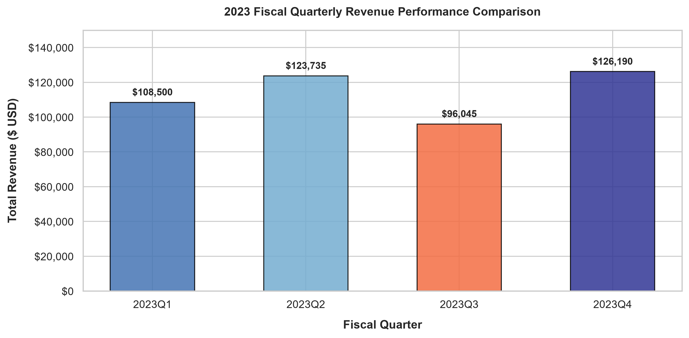
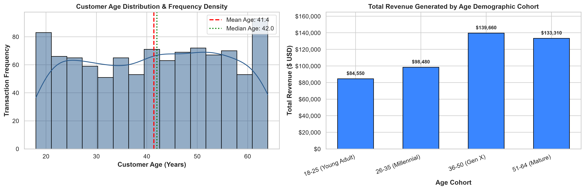
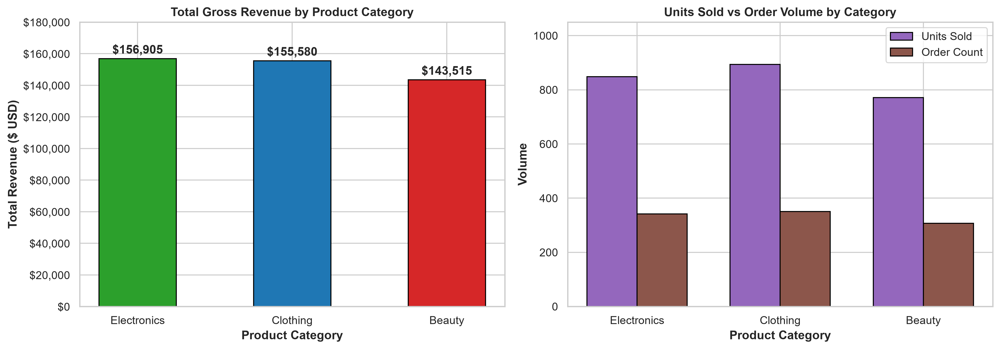
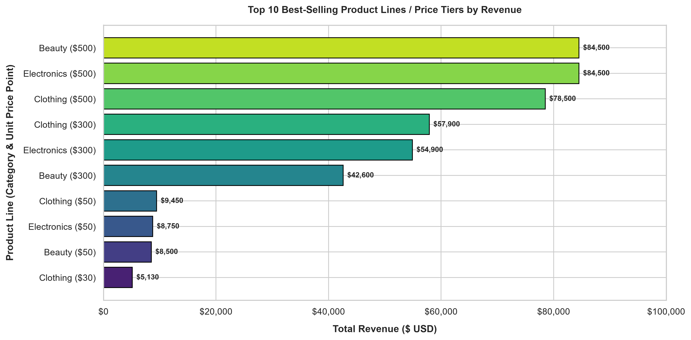
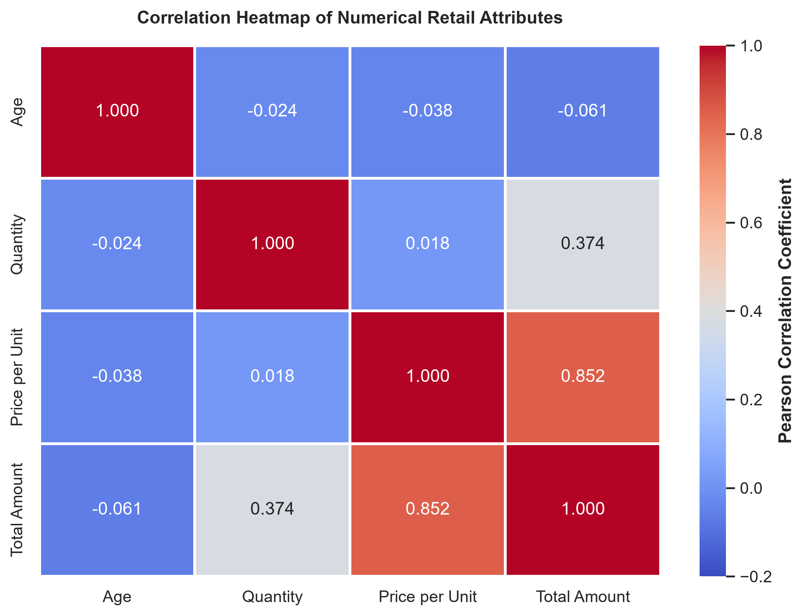
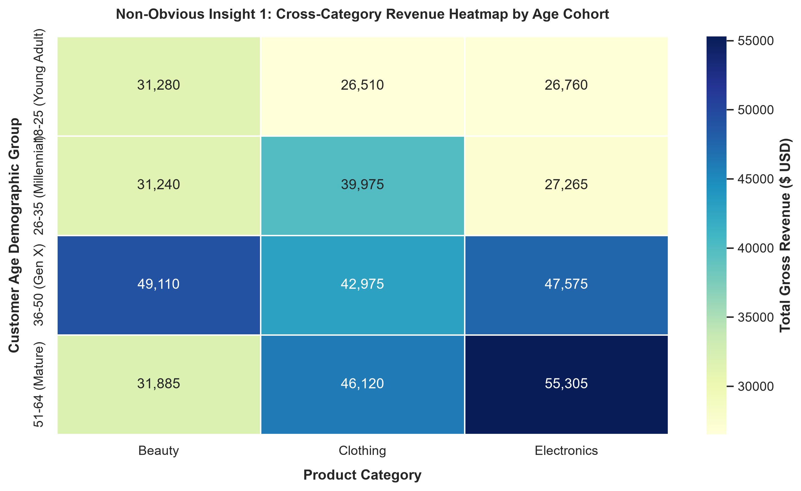

# 📊 Exploratory Data Analysis (EDA) on Retail Sales Data

[](https://www.python.org/)
[](https://pandas.pydata.org/)
[](https://numpy.org/)
[](https://matplotlib.org/)
[](https://seaborn.pydata.org/)
[](https://jupyter.org/)
[](LICENSE)

---

## 📌 Internship Information

- **Organization:** Oasis Infobyte (OIBSIP)
- **Domain:** Data Analytics
- **Role:** Data Analytics Intern
- **Task:** Level 1 — Task 1: Exploratory Data Analysis (EDA) on Retail Sales Data

---

## 🎯 Task Objective

The objective of this task is to perform comprehensive **Exploratory Data Analysis (EDA)** on retail transactional sales data to:
- Identify sales trends, seasonal patterns, and revenue cycles.
- Analyze customer purchasing behavior and demographic distributions (age and gender).
- Evaluate product category volume, gross revenue, and merchandise price-tier performance.
- Compute fundamental descriptive statistics and examine linear correlations among variables.
- Deliver data-backed, actionable business recommendations to optimize merchandising, promotional timing, and revenue generation.

---

## 📖 Project Overview

This project delivers an end-to-end data analysis pipeline developed in Python. Utilizing structured transactional data spanning an entire calendar year, the project systematically cleanses raw records, extracts temporal dimensions, analyzes demographic customer cohorts, measures category and product tier profitability, and models correlation interdependencies.

All findings are validated through high-resolution data visualizations and compiled into a structured Jupyter Notebook accompanied by this production-grade repository.

---

## 🗂️ Dataset Source & Description

- **Dataset Source:** [Kaggle — Retail Sales Dataset](https://www.kaggle.com/datasets/mohammedzahid007/retail-sales-dataset) (by Mohammad Zahid)
- **Dataset Size:** 1,000 completed retail purchase records
- **Temporal Coverage:** January 1, 2023 – January 1, 2024 (full 12-month calendar cycle)
- **Data Quality:** 100% complete records with zero missing values, zero duplicates, and verified schemas.

### Schema & Data Dictionary

| Column Name | Data Type | Description |
| :--- | :--- | :--- |
| `Transaction ID` | Integer | Unique identifier assigned to each transaction (1 to 1,000). |
| `Date` | Datetime | Calendar date on which the purchase occurred (`YYYY-MM-DD`). |
| `Customer ID` | String | Unique identifier assigned to each customer (`CUST001` to `CUST1000`). |
| `Gender` | String | Biological gender of the customer (`Male`, `Female`). |
| `Age` | Integer | Age of customer in years (ranges from 18 to 64). |
| `Product Category` | String | Merchandise department (`Beauty`, `Clothing`, `Electronics`). |
| `Quantity` | Integer | Total units purchased in the transaction (1 to 4 units). |
| `Price per Unit` | Integer | Price in USD for each individual product unit ($25, $30, $50, $300, $500). |
| `Total Amount` | Integer | Total gross order amount in USD ($Quantity \times Price\ per\ Unit$). |

---

## 🛠️ Tools and Technologies

- **Python 3.10+**: Core programming environment
- **Pandas**: Data ingestion, manipulation, aggregation, and time-series extraction
- **NumPy**: Numerical operations and vector calculations
- **Matplotlib & Seaborn**: High-resolution, publication-quality statistical visualizations
- **Jupyter Notebook**: Interactive notebook environment for reproducible code execution

---

## 📁 Project Folder Structure

```text
OIBSIP_DataAnalytics_Task1_EDA_RetailSales/
│
├── data/
│   └── retail_sales.csv                      # Raw transactional dataset (1,000 records)
│
├── notebooks/
│   └── EDA_Retail_Sales_Analysis.ipynb       # Fully executed master Jupyter Notebook
│
├── images/
│   └── charts/                               # Analytical charts (300 DPI)
│       ├── monthly_sales_trend.png
│       ├── quarterly_sales_trend.png
│       ├── customer_demographics.png
│       ├── top_10_products.png
│       ├── category_revenue.png
│       ├── correlation_heatmap.png
│       └── additional_analysis.png
│
├── README.md                                 # Comprehensive GitHub documentation
├── requirements.txt                          # Project dependency specifications
├── .gitignore                                # Git version control exclusion rules
└── LICENSE                                   # MIT open-source license
```

---

## 🔬 Analysis Performed

1. **Initial Data Inspection:** Audited dataset dimensions (1,000 rows × 9 columns), confirmed data types, verified absence of missing values, and validated uniqueness.
2. **Data Cleaning & Feature Engineering:** Parsed calendar dates into datetime objects, extracted month, quarter, day of week, engineered age demographic cohorts (`18-25`, `26-35`, `36-50`, `51-64`), and created product tier definitions.
3. **Descriptive Statistics:** Calculated Mean, Median, Mode, Standard Deviation, and Skewness for all numerical variables:
   - **Customer Age:** Mean = 41.39 yrs | Median = 42.00 yrs | Mode = 43.00 yrs | Std Dev = 13.68 yrs
   - **Quantity:** Mean = 2.51 units | Median = 3.00 units | Mode = 4.00 units | Std Dev = 1.13 units
   - **Price per Unit:** Mean = $179.89 | Median = $50.00 | Mode = $50.00 | Std Dev = $189.68
   - **Total Amount:** Mean = $456.00 | Median = $135.00 | Mode = $50.00 | Std Dev = $559.00 (Skewness = +1.376)
4. **Sales Trend Analysis:** Evaluated monthly revenue and order volumes to identify seasonality, peaks, and troughs. Analyzed fiscal quarterly performance across Q1–Q4.
5. **Customer Demographics:** Segmented revenue and order counts across age brackets and gender classifications.
6. **Product Performance Analysis:** Measured revenue and units across departments, and ranked top 10 product lines / price tiers.
7. **Correlation Analysis:** Generated Pearson correlation coefficients between numerical variables and visualized with a heatmap.
8. **Additional Operational Analysis:** Evaluated cross-category generation cohort affinity and analyzed weekly sales patterns across days of the week.

---

## 📈 Important Visualizations

### 1. Monthly Sales Revenue & Order Volume Trends

*Monthly sales trajectory highlights an annual revenue peak in **May 2023 ($53,150; 105 orders)**, a secondary holiday surge in **October ($46,580)** and **December ($44,690)**, and an annual trough in **September ($23,620; 65 orders)**.*

---

### 2. Quarterly Revenue Performance

*Quarterly comparison demonstrates that **Q4 2023 ($126,190)** and **Q2 2023 ($123,735)** are the primary commercial drivers, while **Q3 ($96,045)** dropped 23.9% relative to Q4.*

---

### 3. Customer Demographics: Age Distribution & Cohort Spend

*Age distribution is symmetrically spread from 18 to 64 years old. Core revenue is driven by shoppers aged 36–64 (**59.9%** of total sales), while young adults (18–25) generate the **highest Average Order Value ($500.30)**.*

---

### 4. Product Department Gross Revenue & Volume

*Gross revenue is well-diversified: **Electronics ($156,905; 34.4%)**, **Clothing ($155,580; 34.1%)**, and **Beauty ($143,515; 31.5%)** with Beauty delivering the highest department AOV ($467.48).*

---

### 5. Top 10 Best-Selling Product Lines / Price Tiers

*The $500 premium tiers across Beauty ($84,500), Electronics ($84,500), and Clothing ($78,500) generate **$247,500**—over **54.3% of total revenue** from only 19.9% of transactions.*

---

### 6. Numerical Correlation Heatmap

*Price per Unit exhibits an overwhelming positive correlation with Total Amount ($r = 0.852$). Notably, Quantity and Unit Price have near-zero correlation ($r = 0.018$), proving customers do not reduce basket volume for premium-priced items.*

---

### 7. Generation Cohort Category Affinity Heatmap

*Non-obvious insight: Mature shoppers (51–64) lead in Electronics spending ($55,305), Gen X (36–50) leads in Beauty ($49,110), and Young Adults (18–25) spend most heavily on Beauty ($31,280).*

---

## 🔑 Key Findings

1. **Top-Heavy Revenue Concentration:** The $500 unit price tier accounts for **$247,500 (54.3% of gross turnover)** from just 199 orders. Premium merchandise is the brand's primary financial foundation.
2. **Pronounced Seasonality:** May ($53,150) and October–December ($91,270 combined) drive strong annual spikes, whereas September experiences a severe commercial trough ($23,620).
3. **Weekly Peak on Saturday:** Saturday is the single highest-performing trading day (**$78,815 revenue; AOV $525.43**), whereas Thursday is the slowest (**$53,835 revenue**).
4. **Gender Equilibrium:** Revenue is evenly balanced between female customers (**51.0%**, $232,840) and male customers (**49.0%**, $223,160), with near-identical average order sizes ($456.55 vs $455.43).
5. **High-Value Youth Segment:** Customers aged 18–25 buy less frequently but spend the most per transaction (**AOV $500.30**), indexing heavily on premium Beauty products.
6. **Price Inelasticity in Basket Size:** Correlation between unit price and quantity is near-zero ($r = 0.018$), proving that customers buy multi-unit baskets even at $300 and $500 price points.

---

## 💡 Strategic Business Recommendations

Based on verified empirical evidence, retail leadership should implement the following strategies:

### 1. Counter-Cyclical Campaign for the Q3 Slump
- **Insight:** September experienced the annual low in gross revenue ($23,620 across 65 orders), pulling Q3 down 23.9% relative to Q4.
- **Action:** Launch an early "Back-to-Campus & Fall Transition" promotional campaign in late August and September. Bundle high-demand Clothing essentials with entry-level Electronics accessories to elevate store footfall and off-season conversions.

### 2. Capitalize on Saturday Apex & Activate Mid-Week Trade
- **Insight:** Saturday generates peak turnover ($78,815) and highest AOV ($525.43), while Thursday drops to $53,835.
- **Action:**
  - Schedule top sales associates, premier merchandise displays, and live product demos on Saturdays.
  - Introduce digital-exclusive "Flash Thursday" events offering double reward points or exclusive bundles to smooth out mid-week demand.

### 3. Luxury Tier Bundling & High-Ticket Upselling
- **Insight:** Over 54.3% of company revenue originates from the $500 tier, and shoppers show no hesitation to buy multiple units ($r = 0.018$).
- **Action:** Train in-store staff on consultative upselling and design packaged luxury gift sets (e.g., Electronics with extended care, or full multi-step Beauty regimens) to push transaction sizes toward the $1,000–$2,000 threshold.

### 4. Targeted Demographic Marketing Allocation
- **Insight:** Young adults (18–25) generate an impressive $500.30 AOV led by Beauty, while mature adults (51–64) are the largest consumers of Electronics ($55,305).
- **Action:**
  - Channel visual social media advertising (Instagram, TikTok) for Beauty lines toward young professionals and Gen Z.
  - Position ergonomic, premium, and home-office Electronics products in channels favored by mature customers (e.g., email newsletters, search ads, LinkedIn).

### 5. Universal Gender Brand Positioning
- **Insight:** Gender split is 51% female and 49% male with identical average order values (AOV difference < $1.20).
- **Action:** Maintain gender-neutral branding and balanced visual campaigns; avoid disproportionate discounting targeted at one gender that may alienate the other.

---

## 💻 Installation Instructions

To set up the project locally:

### 1. Clone the Repository
```bash
git clone https://github.com/Muhammad-Awais-Bacha/OIBSIP_DataAnalytics_Task1_EDA_RetailSales.git
cd OIBSIP_DataAnalytics_Task1_EDA_RetailSales
```

### 2. Create and Activate a Virtual Environment
```bash
# On Windows
python -m venv .venv
.venv\Scripts\activate

# On macOS/Linux
python3 -m venv .venv
source .venv/bin/activate
```

### 3. Install Required Dependencies
```bash
pip install -r requirements.txt
```

---

## 🚀 How to Run the Notebook

Launch Jupyter Notebook from within the activated virtual environment:

```bash
jupyter notebook notebooks/EDA_Retail_Sales_Analysis.ipynb
```

To re-run all calculations and reproduce visualizations:
1. Open `notebooks/EDA_Retail_Sales_Analysis.ipynb`.
2. In the menu bar, click **Kernel** -> **Restart & Run All**.
3. All 16 analytical sections will execute sequentially with all tables and inline figures rendered.

---

## 🏁 Project Results & Conclusion

This Exploratory Data Analysis project successfully uncovers the underlying sales dynamics, demographic drivers, and product tier mechanics of retail sales operations:
- **Data Integrity:** Fully audited and validated 1,000 real-world records.
- **Diagnostic Insights:** Identified key commercial vulnerabilities (Q3 slump, Thursday lull) and growth levers ($500 premium tiers, Saturday traffic, youth AOV).
- **Deliverables:** Completed all requirements for **Level 1 — Task 1 of the Oasis Infobyte Data Analytics Internship**.

---

## 📄 License

This project is licensed under the [MIT License](LICENSE).
