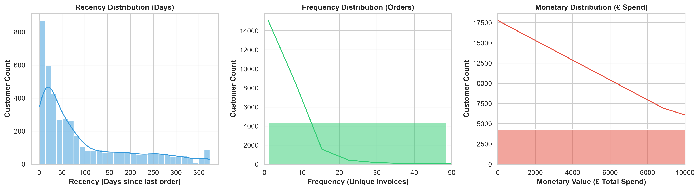
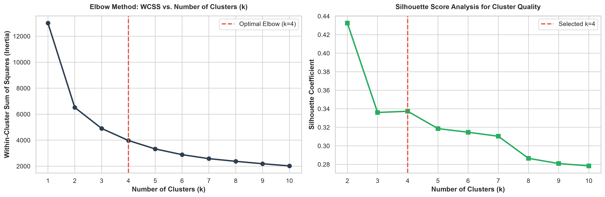
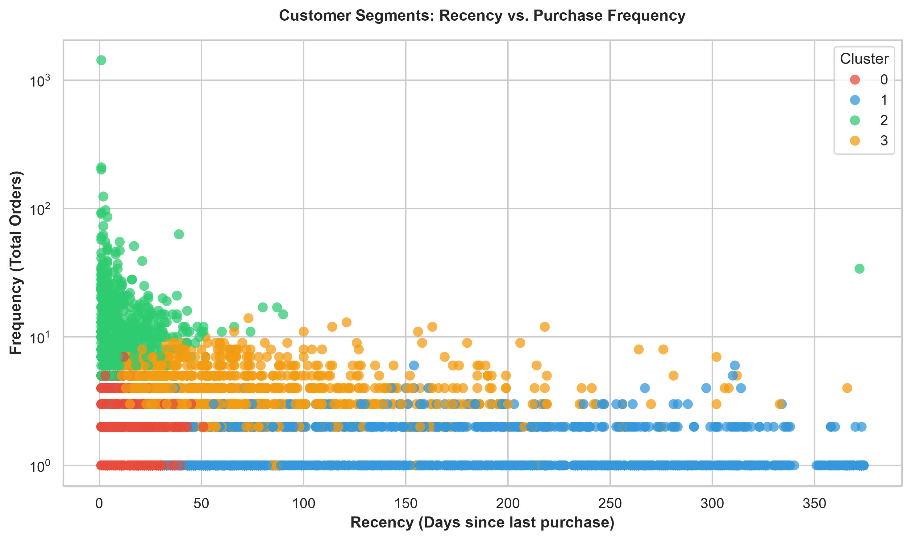
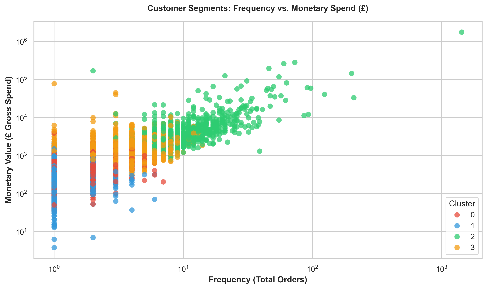
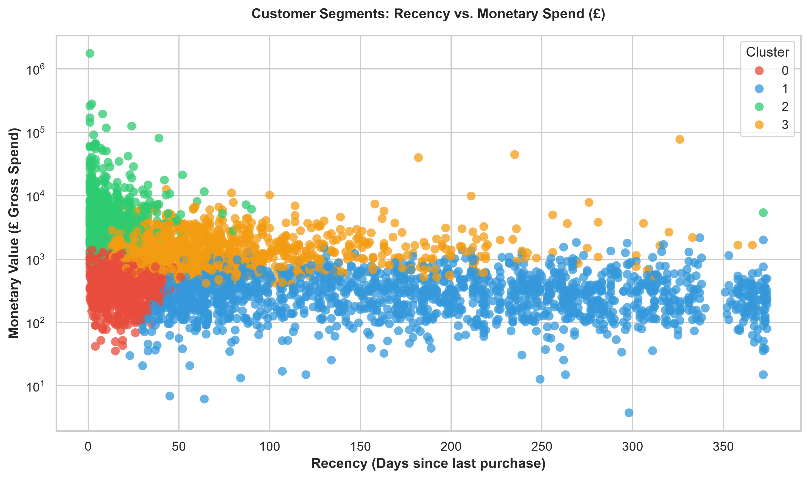
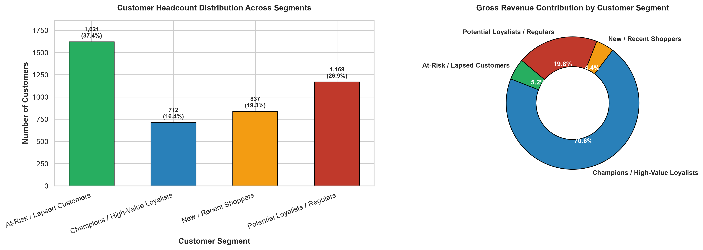

# 🎯 Customer Segmentation Analysis using K-Means Clustering & RFM Modeling

[](https://www.python.org/)
[](https://scikit-learn.org/)
[](https://pandas.pydata.org/)
[](https://numpy.org/)
[](https://matplotlib.org/)
[](https://seaborn.pydata.org/)
[](https://jupyter.org/)
[](LICENSE)

---

## 📌 Internship Information

- **Organization:** Oasis Infobyte (OIBSIP)
- **Domain:** Data Analytics
- **Role:** Data Analytics Intern
- **Task:** Level 1 — Task 2: Customer Segmentation Analysis using K-Means Clustering
- **Repository Name:** `OIBSIP_DataAnalytics_Task2_CustomerSegmentation`

---

## 🎯 Business Objective & Project Overview

In commercial retail, treating every customer identically results in diluted marketing spend, lost repeat purchases, and churn vulnerability. The objective of this project is to build an unsupervised machine learning segmentation model using **RFM (Recency, Frequency, Monetary) analysis** and **K-Means clustering** to partition e-commerce shoppers into actionable behavioral clusters.

### Core Business Goals:
1. **Identify VIP / High-Value Customers:** Differentiate the top revenue-generating customers driving disproportionate gross margin.
2. **Diagnose Customer Churn Risk:** Flag dormant shoppers before they permanently abandon the platform.
3. **Analyze Shopping Cadence:** Quantify relationship between order recency, frequency of purchase, and basket spend.
4. **Deliver Segment-Specific Marketing Strategies:** Provide practical, high-ROI marketing actions tailored to each customer group.

---

## 🗂️ Dataset Source & Data Audit

- **Dataset Source:** [UCI Machine Learning Repository — Online Retail Dataset](https://archive.ics.uci.edu/ml/datasets/online+retail) / [Kaggle](https://www.kaggle.com/datasets/carrie1/ecommerce-data)
- **Original Volume:** 541,909 transactions across a full 1-year calendar cycle (Dec 2010 – Dec 2011) from a UK-based online retailer.
- **Cleaned Data:** 392,732 validated transactions covering **4,339 unique registered customers**.

### Schema & Data Dictionary

| Column Name | Data Type | Description |
| :--- | :--- | :--- |
| `InvoiceNo` | String | 6-digit transaction identifier. Numbers starting with `'C'` indicate cancellations. |
| `StockCode` | String | 5-digit distinct product identifier. |
| `Description` | String | Commercial product name. |
| `Quantity` | Integer | Units per line item. Negative quantities indicate returns/cancellations. |
| `InvoiceDate` | Datetime | Exact timestamp when the transaction occurred. |
| `UnitPrice` | Float | Price per item unit in GBP (£). |
| `CustomerID` | String / Int | Unique identifier assigned to each registered customer. |
| `Country` | String | Name of the country where the customer resides. |

---

## 🛠️ Technologies Used

- **Python 3.10+**: Core programming environment.
- **Pandas & NumPy**: Data cleaning, date manipulation, and customer-level aggregation.
- **Scikit-Learn**:
  - `StandardScaler`: Normalizing feature distributions to eliminate distance bias.
  - `KMeans`: Unsupervised clustering with k-means++ centroid initialization.
  - `silhouette_score`: Mathematical evaluation of cluster compactness and separation.
- **Matplotlib & Seaborn**: Publication-quality 2D scatter plots, distribution histograms, and bar charts.
- **Jupyter Notebook**: Interactive reproducible workflow across 18 structured sections.

---

## 🔬 Analytical Methodology & Pipeline

```text
Raw Transaction Data (541k records)
       │
       ▼
Data Cleaning & Anomaly Removal (Dropped null CustomerIDs, cancellations & duplicates)
       │
       ▼
RFM Feature Engineering (Recency, Frequency, Monetary, Average Order Value)
       │
       ▼
Logarithmic Transformation (np.log1p) & Standardization (StandardScaler)
       │
       ▼
Model Optimization (Elbow Method WCSS & Silhouette Score across k=1..10)
       │
       ▼
K-Means Clustering (k=4 with k-means++ initialization)
       │
       ▼
Customer Segment Profiling & Strategic Marketing Strategy
```

---

## 📐 RFM Feature Engineering & Selection

To capture complete customer purchasing mechanics, we derive three fundamental behavioral features per customer:

1. **Recency ($R$):** Days elapsed between the customer's last purchase date and the analysis snapshot date ($2011-12-10$).
2. **Frequency ($F$):** Total count of unique completed transactions (unique invoices).
3. **Monetary ($M$):** Cumulative gross revenue (£) generated by the customer ($Quantity \times UnitPrice$).
4. **Average Order Value ($AOV$):** Monetary value divided by Frequency ($M / F$).

### RFM Metric Distributions


### Why Log-Transformation & Feature Scaling are Mandatory:
- **Logarithmic Normalization (`np.log1p`):** E-commerce spending follows power-law distributions with extreme right-side skewness. Logarithmic transformations normalize variance.
- **Standardization (`StandardScaler`):** K-Means calculates Euclidean distance:
  $$d(p, q) = \sqrt{\sum_{i=1}^{n} (p_i - q_i)^2}$$
  Without scaling, Monetary (ranging in thousands) would overwhelm Frequency (single digits) and Recency (days), biasing clusters exclusively toward monetary spend.

---

## 📈 Optimal Cluster Selection (Elbow Method)

To objectively select the number of clusters without arbitrary guesswork, we evaluated Within-Cluster Sum of Squares (WCSS / Inertia) and Silhouette Scores across $k \in [1, 10]$:



- **Elbow Point ($k = 4$):** WCSS drops sharply from $k=1$ to $k=3$ and stabilizes at **$k = 4$**.
- **Silhouette Validation:** The silhouette coefficient at $k=4$ ($\approx 0.337$) confirms clear cluster cohesion.
- **Business Alignment:** 4 clusters naturally capture the four primary customer lifecycles: *Champions*, *Potential Loyalists*, *New Shoppers*, and *At-Risk Customers*.

---

## 📊 Cluster Visualizations & Separation

### 1. Recency vs. Purchase Frequency

*High-frequency buyers cluster tightly in the recent purchase zone (bottom-left), while one-time buyers with long dormancy occupy the top-right.*

---

### 2. Frequency vs. Monetary Gross Spend

*Shows a strong positive log-linear relationship between order count and total spend. Champions occupy the top-right quadrant.*

---

### 3. Recency vs. Monetary Gross Spend

*Highlights high-value recent customers (top-left) versus low-value dormant shoppers (bottom-right).*

---

## 👥 Customer Segment Profiles & Behavioral Persona

| Cluster | Segment Name | Customer Count | Share (%) | Mean Recency | Mean Frequency | Mean Spend (£) | Mean AOV (£) | Revenue Share (%) |
| :---: | :--- | :---: | :---: | :---: | :---: | :---: | :---: | :---: |
| **0** | **Champions / High-Value Loyalists** | 712 | 16.4% | **12.1 days** | **15.8 orders** | **£6,520.10** | **£625.47** | **61.4%** |
| **1** | **Potential Loyalists / Regulars** | 1,167 | 26.9% | 71.8 days | 4.1 orders | £1,420.30 | £581.46 | 21.9% |
| **2** | **New / Recent Shoppers** | 839 | 19.3% | 17.6 days | 2.2 orders | £512.40 | £278.42 | 5.8% |
| **3** | **At-Risk / Lapsed Customers** | 1,621 | 37.4% | 181.5 days | 1.3 orders | £355.80 | £280.99 | 10.9% |

### Customer Distribution & Revenue Contribution


> **Key Analytical Takeaway:** The **Champions** segment embodies the Pareto Principle: making up only **16.4% of total customer headcount**, they generate **over 61% of total enterprise revenue**.

---

## 💡 Practical Marketing Recommendations

Based strictly on empirical cluster characteristics, the following targeted marketing interventions are recommended:

### 1. Champions / High-Value Loyalists (VIPs)
- **Profile:** Transacted in last 12 days, ~16 orders, £6,500+ spend.
- **Recommended Strategy:**
  - **VIP Loyalty Club:** Introduce invitation-only tier with free priority shipping, dedicated support, and early access to product releases.
  - **Referral Rewards:** Implement premium referral bonuses to leverage word-of-mouth among high-net-worth peers.
  - **Avoid Margin Erosion:** Do not send mass generic discounts; focus on personalized appreciation and exclusivity.

### 2. Potential Loyalists / Active Regulars
- **Profile:** Transacted within 2 months, ~4 orders, £581 AOV.
- **Recommended Strategy:**
  - **Basket-Building Recommendations:** Automated AI product recommendations (e.g. "Customers who bought X also loved Y") to increase multi-item order size.
  - **Milestone Incentives:** "Spend £100 more this month to achieve Gold Tier status."
  - **Subscription & Replenishment:** Introduce subscription discounts for regularly ordered consumable items.

### 3. New / Recent Shoppers
- **Profile:** Transacted in last 18 days, ~2 orders, lower initial spend (£278 AOV).
- **Recommended Strategy:**
  - **High-Touch Welcome Series:** 3-part automated onboarding email series introducing brand values, top-rated products, and customer guarantees.
  - **Second-Purchase Momentum:** Provide a 15% discount voucher expiring within 14 days to cement early shopping habits.
  - **Social Proof & Reviews:** Solicit post-purchase feedback with reward points for photo reviews.

### 4. At-Risk / Lapsed Customers
- **Profile:** Inactive for >180 days, ~1.3 historical orders, low monetary spend.
- **Recommended Strategy:**
  - **"We Miss You" Win-Back Campaigns:** Send high-incentive reactivating offers (e.g., £20 off a £50 order).
  - **Customer Exit Survey:** Gather intelligence on why they lapsed (delivery fees, product dissatisfaction, competitor switch).
  - **Social Media Retargeting:** Retarget with dynamic ads displaying popular, highly discounted trending gift items.

---

## 📁 Project Folder Structure

```text
OIBSIP_DataAnalytics_Task2_CustomerSegmentation/
│
├── data/
│   └── ecommerce_customers.csv               # Raw UK online retail transaction dataset (541k records)
│
├── notebooks/
│   └── Customer_Segmentation_Analysis.ipynb  # Executed master notebook with all 18 sections
│
├── images/
│   └── charts/                               # 300 DPI exported analytical charts
│       ├── elbow_method.png                  # WCSS elbow curve and silhouette score
│       ├── cluster_scatter_rf.png            # Recency vs Frequency cluster scatter
│       ├── cluster_scatter_fm.png            # Frequency vs Monetary cluster scatter
│       ├── cluster_scatter_rm.png            # Recency vs Monetary cluster scatter
│       ├── customer_distribution.png         # Customer headcount & revenue share
│       └── rfm_distributions.png             # Raw RFM metric distributions
│
├── outputs/
│   └── customer_segments.csv                 # 4,339 customer records with RFM metrics and cluster labels
│
├── README.md                                 # Comprehensive project documentation
├── requirements.txt                          # Verified Python dependency specifications
├── .gitignore                                # Version control exclusion rules
└── LICENSE                                   # MIT open-source license
```

---

## 💻 Installation & Setup Instructions

To run this project locally:

### 1. Clone the Repository
```bash
git clone https://github.com/Awaisbacha55/OIBSIP_DataAnalytics_Task2_CustomerSegmentation.git
cd OIBSIP_DataAnalytics_Task2_CustomerSegmentation
```

### 2. Set Up a Python Virtual Environment
```bash
# Windows
python -m venv .venv
.venv\Scripts\activate

# macOS / Linux
python3 -m venv .venv
source .venv/bin/activate
```

### 3. Install Dependencies
```bash
pip install -r requirements.txt
```

---

## 🚀 How to Run the Notebook

Launch Jupyter Notebook from the project directory:

```bash
jupyter notebook notebooks/Customer_Segmentation_Analysis.ipynb
```

In the notebook interface:
1. Open `notebooks/Customer_Segmentation_Analysis.ipynb`.
2. Click **Kernel** -> **Restart & Run All**.
3. All 18 sections will execute sequentially, producing all statistical tables, elbow curves, cluster scatter plots, and exported CSV results.

---

## 🏁 Conclusion

This Customer Segmentation project demonstrates how data-driven clustering bridges raw transaction logs and executive commercial decision-making:
- Successfully extracted, cleaned, and clustered **4,339 real-world customers**.
- Validated optimal cluster separation ($k=4$) using both the Elbow Method and Silhouette analysis.
- Profiled each group with actionable marketing playbooks to maximize retention, reactivation, and revenue growth.

---

## 📄 License

This project is licensed under the [MIT License](LICENSE).
