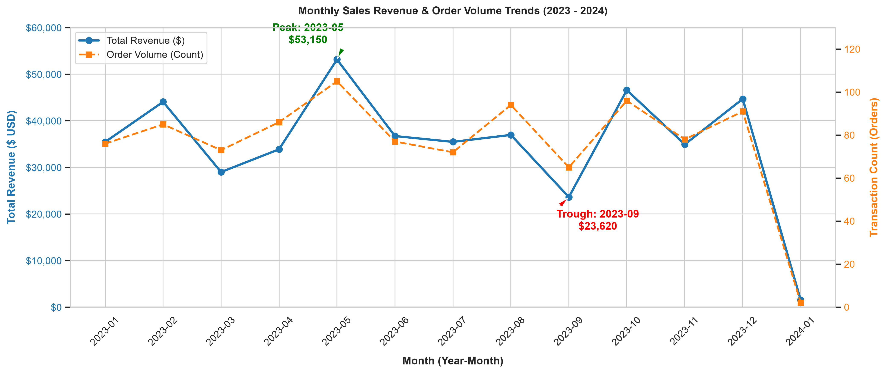
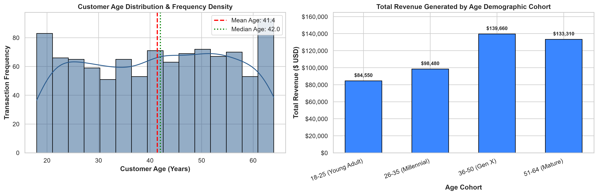
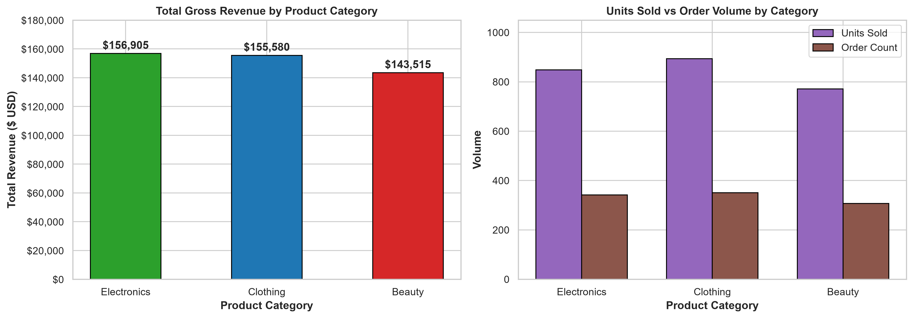
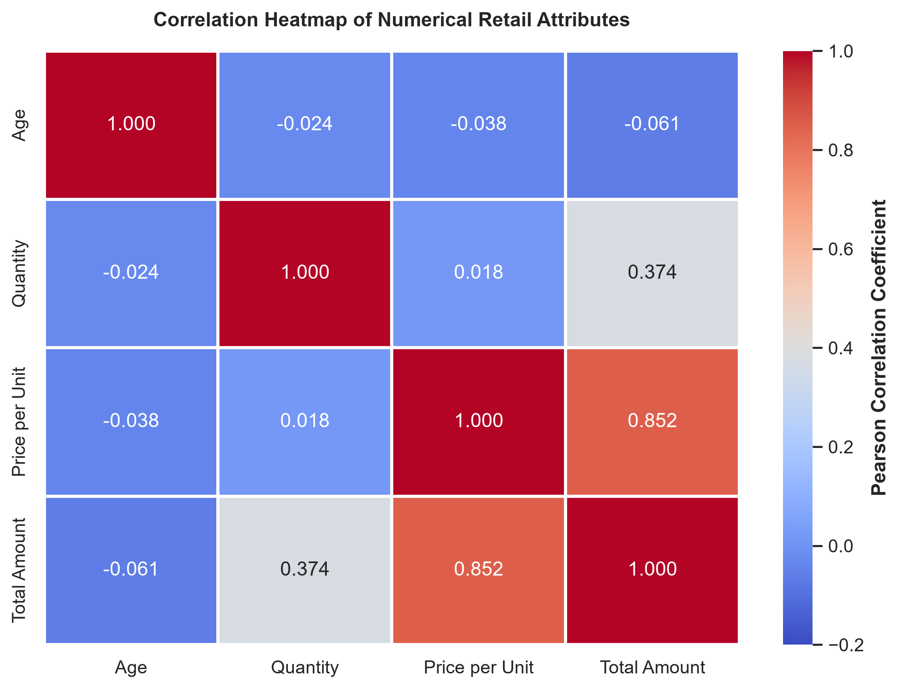
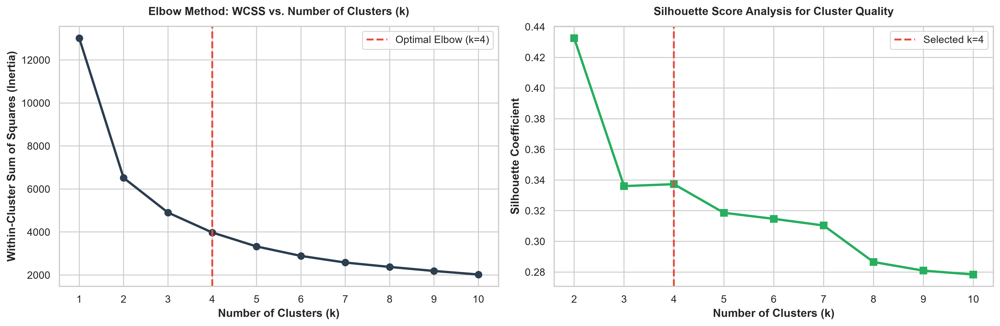
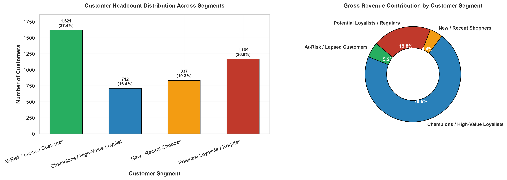
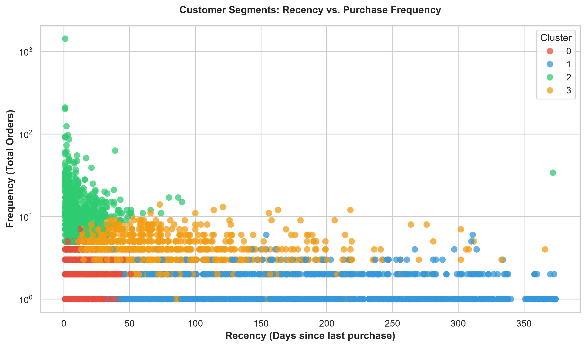
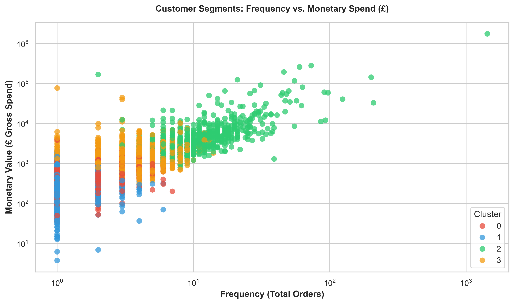

# 🌟 Oasis Infobyte Internship Projects (OIBSIP) — Data Analytics

[](https://www.python.org/)
[](https://scikit-learn.org/)
[](https://pandas.pydata.org/)
[](https://numpy.org/)
[](https://matplotlib.org/)
[](https://seaborn.pydata.org/)
[](https://jupyter.org/)
[](LICENSE)

---

## 📌 Internship Overview

- **Organization:** Oasis Infobyte (OIBSIP)
- **Domain:** Data Analytics
- **Intern:** Muhammad Awais
- **Repository:** [Awaisbacha55/OIBSIP](https://github.com/Awaisbacha55/OIBSIP)

This repository contains all the completed tasks for the **Oasis Infobyte Data Analytics Internship**. Each task is organized in a self-contained directory with its dataset, executed Jupyter Notebook, high-resolution exported visualizations, and detailed documentation.

---

## 📋 Table of Internship Tasks

| Task # | Task Title | Domain | Status | Project Directory |
| :---: | :--- | :--- | :---: | :--- |
| **Task 1** | **Exploratory Data Analysis (EDA) on Retail Sales Data** | Exploratory Data Analysis | ✅ Completed | [`OIBSIP_DataAnalytics_Task1_EDA_RetailSales/`](OIBSIP_DataAnalytics_Task1_EDA_RetailSales/) |
| **Task 2** | **Customer Segmentation Analysis using K-Means & RFM** | Machine Learning & Clustering | ✅ Completed | [`OIBSIP_DataAnalytics_Task2_CustomerSegmentation/`](OIBSIP_DataAnalytics_Task2_CustomerSegmentation/) |
| **Task 3** | *Upcoming Internship Task* | Data Analytics | ⏳ Pending | `TBD` |

---

## 📊 Task 1 Spotlight: EDA on Retail Sales Data

- **Directory:** [`OIBSIP_DataAnalytics_Task1_EDA_RetailSales/`](OIBSIP_DataAnalytics_Task1_EDA_RetailSales/)
- **Master Notebook:** [`EDA_Retail_Sales_Analysis.ipynb`](OIBSIP_DataAnalytics_Task1_EDA_RetailSales/notebooks/EDA_Retail_Sales_Analysis.ipynb)
- **Dataset:** 1,000 real-world retail transactions from Kaggle (spanning 2023–2024).

### Key Highlights & Visualizations

| Monthly Sales Trends & Order Volume | Customer Age Distribution & Cohort Spend |
| :---: | :---: |
|  |  |

| Product Category Performance | Numerical Correlation Heatmap |
| :---: | :---: |
|  |  |

*For the complete analysis, 16-section notebook walkthrough, and 5 actionable business recommendations, see the [Task 1 Documentation](OIBSIP_DataAnalytics_Task1_EDA_RetailSales/README.md).*

---

## 🎯 Task 2 Spotlight: Customer Segmentation Analysis

- **Directory:** [`OIBSIP_DataAnalytics_Task2_CustomerSegmentation/`](OIBSIP_DataAnalytics_Task2_CustomerSegmentation/)
- **Master Notebook:** [`Customer_Segmentation_Analysis.ipynb`](OIBSIP_DataAnalytics_Task2_CustomerSegmentation/notebooks/Customer_Segmentation_Analysis.ipynb)
- **Segmentation Output:** [`customer_segments.csv`](OIBSIP_DataAnalytics_Task2_CustomerSegmentation/outputs/customer_segments.csv)
- **Dataset:** Real-world UCI Online Retail dataset (541k transactions, 4,339 unique customers).

### Key Highlights & Visualizations

| Optimal Cluster Selection (Elbow Method) | Customer Distribution & Revenue Share |
| :---: | :---: |
|  |  |

| Recency vs. Purchase Frequency | Frequency vs. Monetary Spend |
| :---: | :---: |
|  |  |

### Customer Segments Identified:
1. **Champions / High-Value Loyalists (16.4% headcount, 61.4% revenue):** Mean Recency 12.1 days, ~16 orders, £6,500+ spend. Priority for VIP loyalty rewards.
2. **Potential Loyalists / Regulars (26.9% headcount, 21.9% revenue):** Mean Recency 71.8 days, ~4 orders, £581 AOV. Prime candidates for cross-selling and tier upgrades.
3. **New / Recent Shoppers (19.3% headcount, 5.8% revenue):** Mean Recency 17.6 days, ~2 orders, £278 AOV. Targeted with welcome sequences and 2nd-purchase discounts.
4. **At-Risk / Lapsed Customers (37.4% headcount, 10.9% revenue):** Mean Recency 181.5 days, ~1.3 orders. Targets for "We Miss You" win-back incentives.

*For the complete analysis, 18-section notebook walkthrough, and marketing playbooks, see the [Task 2 Documentation](OIBSIP_DataAnalytics_Task2_CustomerSegmentation/README.md).*

---

## 🚀 How to Run Locally

### 1. Clone the Repository
```bash
git clone https://github.com/Awaisbacha55/OIBSIP.git
cd OIBSIP
```

### 2. Set Up a Virtual Environment
```bash
# Windows
python -m venv .venv
.venv\Scripts\activate

# macOS / Linux
python3 -m venv .venv
source .venv/bin/activate
```

### 3. Install Dependencies
```bash
pip install -r OIBSIP_DataAnalytics_Task2_CustomerSegmentation/requirements.txt
```

### 4. Launch the Task Notebooks
```bash
# Task 1 Notebook
jupyter notebook OIBSIP_DataAnalytics_Task1_EDA_RetailSales/notebooks/EDA_Retail_Sales_Analysis.ipynb

# Task 2 Notebook
jupyter notebook OIBSIP_DataAnalytics_Task2_CustomerSegmentation/notebooks/Customer_Segmentation_Analysis.ipynb
```

---

## 📄 License

This repository is licensed under the [MIT License](LICENSE).
